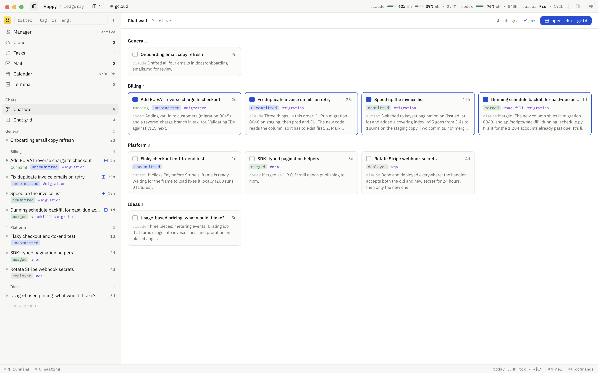
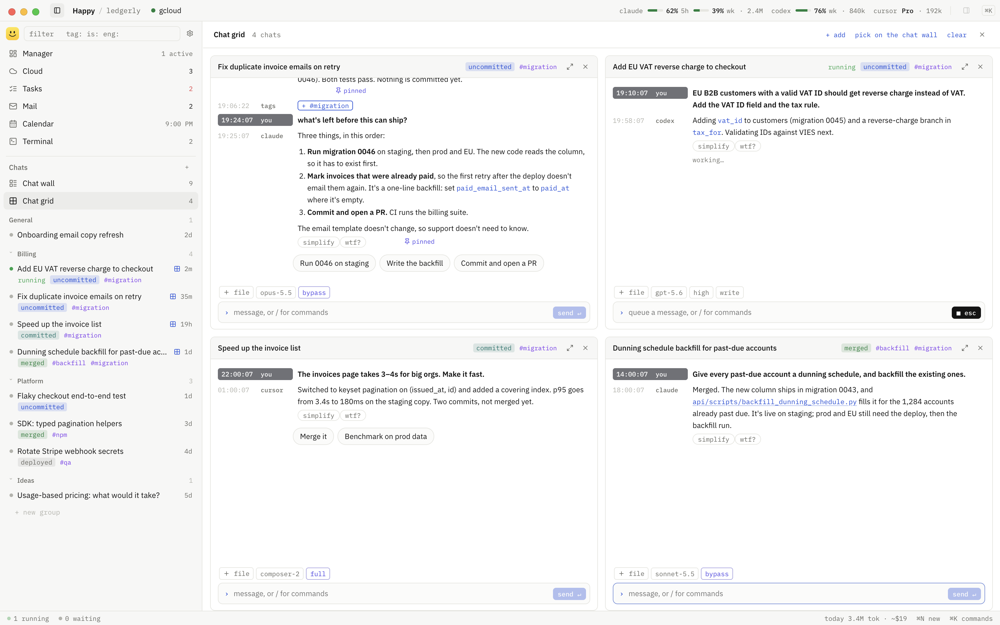
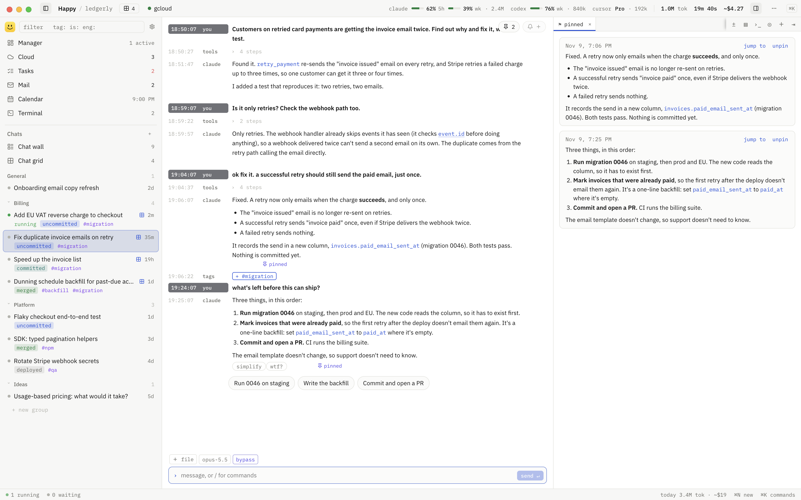
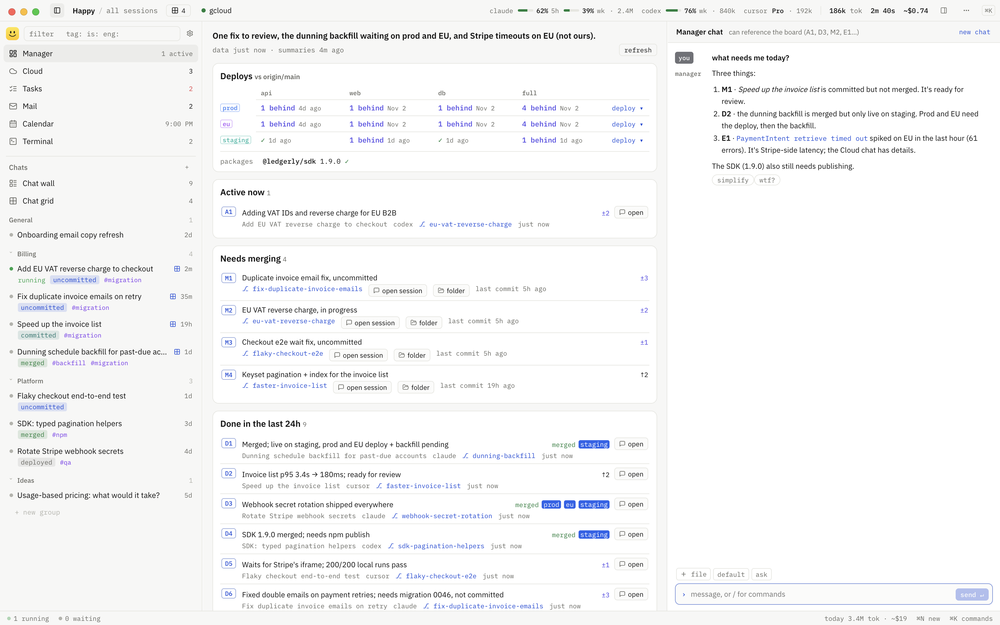
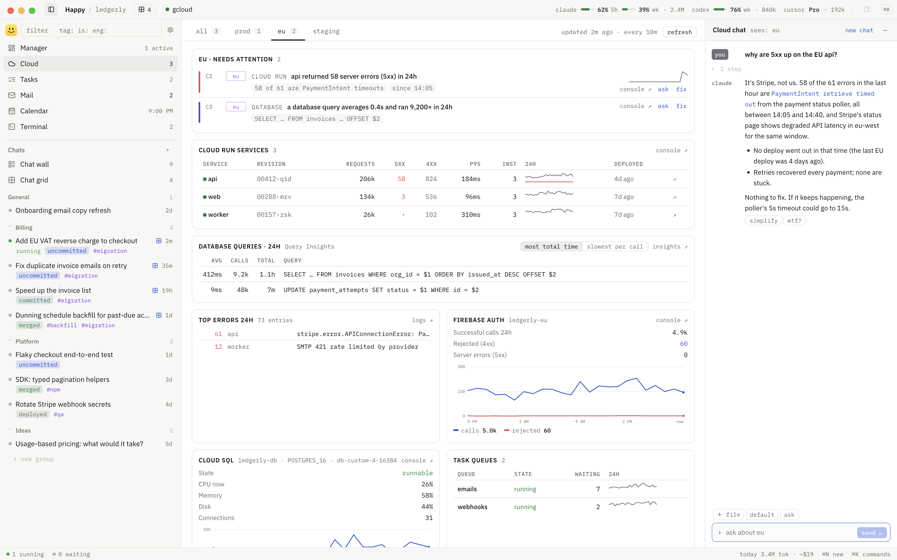
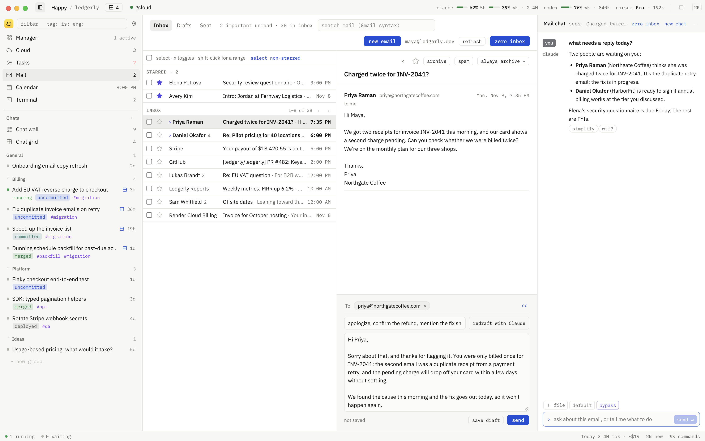
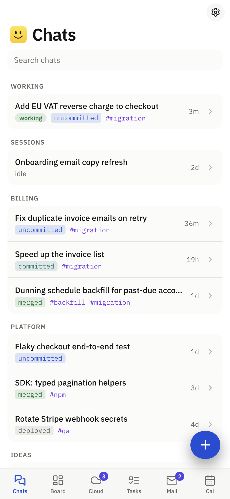

<div align="center">
  
  <h1>Happy</h1>
  <p>Yet another agent harness. Happy is a Mac app for managing massively concurrent coding sessions across multiple providers, as well as cloud infra, tasks and interactions, all in one place.</p>
</div>

<br>

### Why

This new age of software development has taught me a few things:

1. I have little patience for swapping between surfaces (Claude, Codex, Terminal, Cloud, Email, Tasks, etc.).
2. Using Claude/Codex/Cursor in parallel, with multiple agents in each, makes it excruciatingly hard to manage sessions: tracking the status of each, making sure I've merged and deployed the changes, and remembering to run backfills. I often have around 20 agents running at once.
3. I constantly find myself repeating certain tasks. Checking cloud errors. Asking an agent to simplify its response. Scrolling between pinned messages. Asking it to read or draft emails.

Happy is the product of all this: one place for coding agents, cloud, tasks and email, with chat built into UIs where UI is preferable. Session tools help track what's done and what's left. Macros handle the repetitive bits. And I can pick it all up from my phone.

<div align="center">
  <picture>
    <source media="(prefers-color-scheme: dark)" srcset="docs/screenshots/wall-dark.png">
    
  </picture>
</div>

### Sessions

Claude, Codex and Cursor sessions sit together, using your subscriptions to connect.

Happy runs the real agents, so your existing setup carries over: CLAUDE.md and AGENTS.md, skills, MCP servers, hooks, settings and logins. Sessions are saved where each agent saves them, so you can resume a Happy session from the CLI or the Codex app.

All the typical bells and whistles are there, of course: file display, agentic browsing, shell commands, scheduled automations, grouping, etc.

#### Worktrees and deployments

Each session tracks its own worktrees. Worktrees created by the agent are added automatically. For each worktree you see uncommitted files, commits ahead of main, whether it's merged, and which environments it's deployed to. The session sidebar shows this status at a glance; hover for a detailed breakdown in the tooltip.

#### Chat wall and chat grid

- **Chat wall** shows all your active chats and their latest messages. Open a chat in a lightweight modal to read, reply or take action, then return to the wall without navigating away.
- **Chat grid** lets you view and control as many chats as you want side by side. Read replies and send messages directly in each chat, with more chats a scroll away.

<div align="center">
  <picture>
    <source media="(prefers-color-scheme: dark)" srcset="docs/screenshots/grid-dark.png">
    
  </picture>
</div>

#### Next steps

When an agent finishes a reply, Happy asks it, out of sight, what you'd most likely want next. The answer shows up as 2 to 4 buttons under the reply, like "Run the tests" or "Deploy to staging". Click one to send it, or ignore them and type your own. The agent answers with the whole session in mind, not just its last message. The question and answer never show up in the chat.

#### Tags

Sessions can be tagged. I use tags to denote work that needs to be done outside of coding, like backfill, migration, mcp-publish and manual-qa. But they can be anything.

Happy keeps them up to date for you. After each reply, the agent checks the session against those meanings, adds a tag when it applies and removes it once it's done (the backfill ran, the migration was applied, the package was published).

#### Everyday shortcuts

- A `wtf` button under each agent message that asks the agent where things stand: what's done and what's left.
- A `simplify` button under each agent message to make the reply more succinct, in place.
- Pinned messages collect in the side panel.
- Reminders and follow-ups in any session, with notifications when they're due.
- One button to kill all processes an agent is running.
- The top bar shows remaining usage and the API-equivalent cost of each session.

<details>
<summary><b>Session view with pinned messages and next steps</b></summary>

<br>

<div align="center">
  <picture>
    <source media="(prefers-color-scheme: dark)" srcset="docs/screenshots/sessions-dark.png">
    
  </picture>
</div>

</details>

### Manager

One board to view all active session context: what's running, what's unmerged, what's been done. It also shows deployed versions across services and tenants (with one-click deploys handed off to a shell), as well as production errors. A built-in Manager session has context from the page, so you can ask about anything on it or have it resolve things by handing work off to separate sessions.

<div align="center">
  <picture>
    <source media="(prefers-color-scheme: dark)" srcset="docs/screenshots/manager-dark.png">
    
  </picture>
</div>

### Cloud

For Google Cloud: Cloud Run services and jobs, Scheduler, Tasks queues, Cloud SQL and its slowest queries, Firebase auth, and error logs, per environment. One click spawns a session to investigate or fix an issue. There's also a built-in Cloud session with context from the page that you can chat with.

Refresh your cloud authentication in one click.

<div align="center">
  <picture>
    <source media="(prefers-color-scheme: dark)" srcset="docs/screenshots/cloud-dark.png">
    
  </picture>
</div>

### Tasks, mail and calendar

- **Linear.** Your issues and your team's, editable in place. Start an agent on an issue, or have an agent create a new issue.
- **Gmail.** A mail chat that reads, archives, stars, labels and drafts. "Zero inbox" is one click to clean up garbage. An inline agent helps with drafting replies.
- **Calendar.** Mostly just for viewing. You can have agents create events here as well.

<div align="center">
  <picture>
    <source media="(prefers-color-scheme: dark)" srcset="docs/screenshots/mail-dark.png">
    
  </picture>
</div>

### Phone

Turn on phone access and the same app is served to your phone over Tailscale. You get sessions, the board, cloud, mail and tasks, plus a push notification when an agent needs you.

<div align="center">
  <picture>
    <source media="(prefers-color-scheme: dark)" srcset="docs/screenshots/phone-dark.png">
    
  </picture>
</div>

### Known limitations

Happy is built around my workflow, so the integrations reflect what I use. If you need Slack, a task system other than Linear, or a cloud provider other than GCP, you can add those integrations yourself. Hopefully this gives you an easier starting point than building it all from scratch.

Happy currently uses your agent subscriptions; API access is not supported yet.

### Data

Sessions and settings are in `~/Library/Application Support/session-hub`. API keys and Google tokens are encrypted with the macOS keychain. Your agent logins stay with the agents.

Happy only talks to the agents' own services, plus whatever you connect (Google, Linear, npm) and the pages behind links you post.

### Code

Electron, React and Vite. `src/main` is the main process, `src/renderer` the desktop UI, `src/renderer/mobile` the phone UI, and `src/shared` the types and IPC between them.

macOS only for now.

### Install

You need an Apple Silicon Mac, Node 22+, git, and at least one agent CLI that's already signed in: Claude Code (`claude`), Codex (`codex login`) or Cursor (`agent login`).

```bash
git clone https://github.com/ztothewang/happy ~/Code/happy
cd ~/Code/happy && npm install && npm run app
```

This builds Happy.app, puts it in `/Applications` and opens it. Keep the folder around. **Settings → App → Update & restart** pulls and rebuilds from it.

`npm run dev` runs it from the folder without installing.

[docs/setup.md](docs/setup.md) covers the optional parts: the Google client for mail and calendar, the Linear key, gcloud, and the phone.

#### Phone access with Tailscale (optional)

1. Install Tailscale on your [Mac](https://tailscale.com/docs/install/mac) and [phone](https://tailscale.com/download). Sign in with the same account and connect both devices.
2. In Happy on your Mac, turn on **Settings → Phone access**. If prompted, follow the link to enable HTTPS certificates and Tailscale Serve. Happy shows an address and a pairing code.
3. Open that address on your phone and enter the pairing code. On iPhone, use Safari, then tap **Share → Add to Home Screen**.
4. Open Happy from your home screen and enable **Settings → This phone → Notifications** to get notified when an agent needs you.

Keep Happy running on your Mac and Tailscale connected on both devices. Turn on **Keep this Mac awake** in Happy if you want to use it while you're away.

### License

MIT. See [LICENSE](LICENSE).
